# Sampling a 7-Lobed Ring Density with Langevin Dynamics, MALA, and HMC

This project implements four gradient-based samplers in **JAX** for a non-Gaussian 2D target density. It checks them two ways:

- **Weak order of accuracy** for the two SDE discretizations (Euler–Maruyama and BAOAB).
- **Equilibrium acceptance rate** for the two Metropolis-corrected methods (MALA and HMC).

Also samples from HMC train a **RealNVP-style normalizing flow** (PyTorch, `normflows`) as a generative model of the density.

---

## 1. The Problem

We want to sample from

$$
p(x) = \frac{1}{Z}\,\big[2 + \cos(7\theta(x))\big]\; r(x)^2\; e^{-\frac{(r(x)-5)^2}{2}},
$$

where $r(x) \ge 0$ and $\theta(x) \in [0, 2\pi)$ are the polar coordinates of $x \in \mathbb{R}^2$. The density is a **ring of radius ≈ 5**. The $2+\cos 7\theta$ factor gives it **7 angular lobes**, and the angular density varies by a factor of 3 between peaks and troughs.

The samplers we test are:

1. Overdamped Langevin dynamics, via **Euler–Maruyama**
2. Underdamped Langevin dynamics ($\gamma = 1$), via **BAOAB**
3. **MALA** (Metropolis-Adjusted Langevin Algorithm)
4. **Hamiltonian Monte Carlo**

Initialization is $X_0 \sim \mathcal N(0, I)$ (and $V_0 \sim \mathcal N(0, I)$ where a velocity is needed). We also ask:

- For (1) and (2): can we empirically validate the **weak order** of accuracy as $h \to 0^+$, using $\mathbb E[r(X(T))^2]$?
- For (3) and (4): can we empirically quantify the **equilibrium acceptance rate** as $h \to 0^+$, validating with the same expectation?
- **Extra credit:** train a generative model for $p$ on a large set of samples.

---

## 2. Potential and Gradients

Every sampler uses the potential $U(x) = -\log p(x)$ (up to the constant $\log Z$, which disappears under differentiation). The potential is written once in `get_U`:

```python
r = jnp.sqrt(x1**2 + x2**2 + 1e-6)      # 1e-6 keeps r and ∇r finite at the origin
theta = jnp.arctan2(x2, x1)
log_p = jnp.log((2 + jnp.cos(7*theta)) * r**2 * jnp.exp(-((r - 5)**2) / 2))
U_x = -log_p
```

JAX automatic differentiation supplies the gradient, vectorized over all particles: `vmap(grad(get_U))`, as the assignment recommends. `batch_U = vmap(get_U)` gives batched potential values for the Metropolis acceptance ratios.

Every experiment runs **many independent chains in parallel**: 20,000 to 5,000,000 particles stored as one `(N, 2)` array. Results use the **final state of each chain**, so each plot shows an ensemble of N independent samples at time T, not the trajectory of a single chain.

---

## 3. The Samplers

### 3.1 Overdamped Langevin: Euler–Maruyama

$$
dX = -\nabla U(X)\,dt + \sqrt{2}\,dW
\quad\Longrightarrow\quad
X_{n+1} = X_n - h\,\nabla U(X_n) + \sqrt{2h}\,Z_n,\quad Z_n \sim \mathcal N(0,I)
$$

The step is `euler_maruyama_step` (JIT-compiled). The driver is `overdamped_langevin_sampling`, which splits a fresh PRNG key at every step.

### 3.2 Underdamped Langevin ($\gamma=1$): BAOAB

$$
dX = V\,dt,\qquad dV = -\nabla U(X)\,dt - \gamma V\,dt + \sqrt{2\gamma}\,dW
$$

Each step applies five sub-steps in the order **B → A → O → A → B**:

| Sub-step | Update | Function |
|---|---|---|
| **B** (half kick) | $v \leftarrow v - \tfrac h2 \nabla U(x)$ | `run_B` |
| **A** (half drift) | $x \leftarrow x + \tfrac h2 v$ | `run_A` |
| **O** (exact OU solve) | $v \leftarrow e^{-h} v + \sqrt{1-e^{-2h}}\,z$ | `run_O` |

`underdamped_langevin_sampling` returns only the positions.

### 3.3 MALA

MALA uses the Euler–Maruyama step as a **proposal** and accepts it with the Metropolis–Hastings probability

$$
\alpha = \min\!\left(1,\; \frac{p(x')\,q(x \mid x')}{p(x)\,q(x' \mid x)}\right),\qquad
\log q(x_{\text{to}} \mid x_{\text{from}}) = -\frac{1}{4h}\big\|x_{\text{to}} - (x_{\text{from}} - h\nabla U(x_{\text{from}}))\big\|^2 .
$$

- Everything is computed in log-space (`log_transition`), and $\log\alpha$ is capped at 0.
- The test is `log(u) < log_prob` with $u \sim \mathcal U(0,1)$, applied per particle through `jnp.where`.
- `MALA_step` also returns the fraction of particles accepted at that step. `run_MALA` averages these fractions over all steps to report an acceptance rate.

### 3.4 Hamiltonian Monte Carlo

- **Integrator:** Störmer–Verlet (leapfrog) with $n$ steps of size $h$, written with `lax.scan` (`leapfrog_step`, `stormer_verlet`). $n$ is a static argument so JAX can compile the loop.
- **Each HMC iteration** (`hmc_step`):
  1. Resample the momentum $w \sim \mathcal N(0, I)$.
  2. Compute $H = \tfrac12\|w\|^2 + U(x)$.
  3. Integrate to the proposal.
  4. Accept with probability $\min(1, e^{H_{\text{curr}} - H_{\text{prop}}})$.
- **Outer loop** (`HMC`): also a `lax.scan`. The first 20% of iterations are dropped from the acceptance-rate average (`burn_in=0.2`). The returned positions are always the final state.

---

## 4. Results: Samples from Each Method

The first four runs use 20,000 particles initialized from $\mathcal N(0, I)$. Settings:

| Method | Step size $h$ | Steps | Total time / trajectory |
|---|---|---|---|
| Overdamped (EM) | $10^{-3}$ | 20,000 | $T = 20$ |
| Underdamped (BAOAB) | $10^{-3}$ | 20,000 | $T = 20$ |
| MALA | $10^{-3}$ | 20,000 | $T = 20$ |
| HMC | $0.05$ | 5,000 iterations × 20 leapfrog steps | trajectory length $nh = 1.0$ per iteration |

| Overdamped Langevin (EM) | Underdamped Langevin (BAOAB) |
|---|---|
| 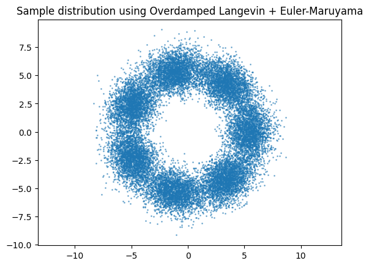 | 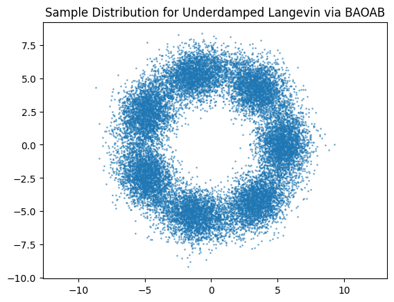 |
| **MALA** | **HMC** |
| 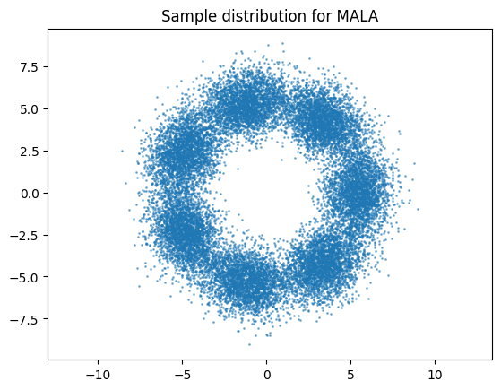 | 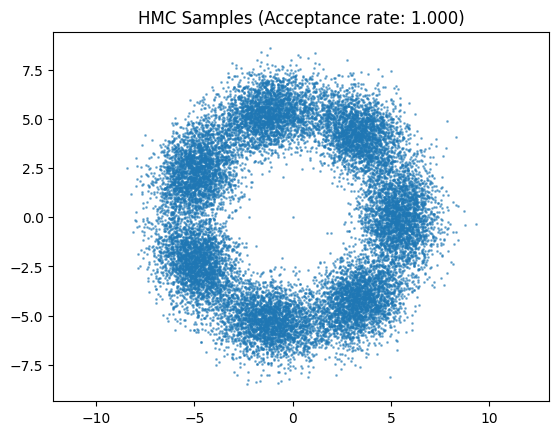 |

**What the plots show:**

- All four samplers start at a Gaussian centered on the origin, travel out to the ring, and recover the target's shape: a hollow annulus at $r \approx 5$ (points reach roughly $3 \lesssim r \lesssim 9$) with **7 clearly separated lobes**, one at each maximum of $\cos 7\theta$.
- The four sample clouds look nearly identical by eye.
- HMC reports an acceptance rate of **1.000** (to 3 decimals) at $h = 0.05$ with 20 leapfrog steps.
- The MALA run computes an acceptance rate but does not print it. Section 5.2 quantifies MALA's acceptance rate.

---

## 5. Validation Experiments

All validation runs use the same test statistic, $\mathbb E[r(X(T))^2] = \mathbb E[\|X(T)\|^2]$.

To skip the long transient from the origin, particles start **uniformly on the circle $r = 5$** (velocities for BAOAB drawn from $\mathcal N(0, I)$).

Each method is compared against a **reference run of the same scheme with $h = 10^{-4}$**. The reported error is $\big|\widehat{\mathbb E}_h[r^2] - \widehat{\mathbb E}_{\text{ref}}[r^2]\big|$.

### 5.1 Weak order of accuracy (Euler–Maruyama and BAOAB)

Theory predicts weak order **1** for Euler–Maruyama and weak order **2** for BAOAB. Both experiments use **5,000,000 particles** integrated to **T = 5**.

#### Overdamped Langevin / Euler–Maruyama

Reference (h = 1e-4, 50,000 steps): **E[r²] = 31.75778**

| $h$ | Steps | Weak error |
|---|---|---|
| 0.1 | 50 | 1.02e-1 |
| 0.05 | 100 | 4.23e-2 |
| 0.025 | 200 | 1.44e-2 |
| 0.0125 | 400 | 1.37e-2 |
| 0.00625 | 800 | 7.35e-3 |
| 0.003125 | 1600 | 5.83e-3 |

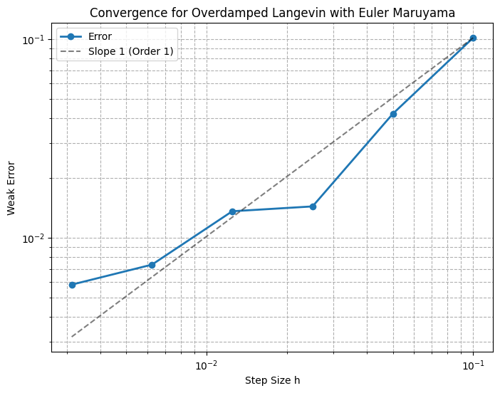

- **A least-squares fit of log(error) vs. log(h) over all six points gives a slope of 0.808**, close to the theoretical order 1.
- Over the range h = 0.1 → 0.003125 (32× smaller), the error falls ≈ 17.5×. Exact first-order convergence would give 32×.
- The plot follows the slope-1 guide line overall but not smoothly:
  - For the coarsest step sizes, the slope is steeper than 1. The fit over just the first three points (h = 0.1 to 0.025) is ≈ 1.41.
  - For the finest step sizes, the error flattens: 1.44e-2 to 1.37e-2 between h = 0.025 and 0.0125.
- The flattening is consistent with **Monte Carlo noise**. Each $h$ and the reference use independent random draws, so a sampling-error floor of roughly $10^{-2}$ remains on top of the discretization error. Below that floor, the bias can no longer be resolved.

#### Underdamped Langevin / BAOAB

Reference (h = 1e-4, 50,000 steps): **E[r²] = 32.09948**

BAOAB stays stable at much larger step sizes, so the sweep uses h ∈ {1, 0.5, 0.25, 0.125}:

| $h$ | Steps | Weak error |
|---|---|---|
| 1.0 | 5 | 2.66e-1 |
| 0.5 | 10 | 5.41e-2 |
| 0.25 | 20 | 1.38e-2 |
| 0.125 | 40 | 1.11e-2 |

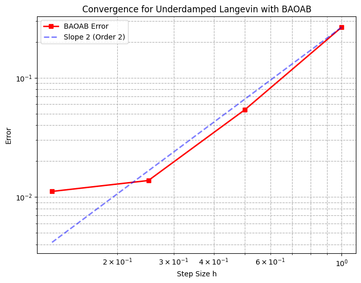

- **A least-squares fit over all four points gives a slope of 1.570.**
- The first three points match second order closely. Halving $h$ cuts the error by ≈ 4.9× (1 → 0.5), then ≈ 3.9× (0.5 → 0.25). Those correspond to local slopes of ≈ 2.3 and ≈ 2.0, and a fit over those three points gives ≈ 2.13.
- At h = 0.125 the error only drops from 1.38e-2 to 1.11e-2, the same ~1e-2 Monte Carlo floor seen for EM. This one point pulls the overall slope down to 1.57.
- **Conclusion:** both schemes behave as theory predicts (order 1 for EM, order 2 for BAOAB) until the statistical noise floor takes over.
- BAOAB reaches a ~1e-2 error with h = 0.25 (20 steps). Euler–Maruyama needs h ≈ 0.0125–0.025 (200–400 steps) for the same error, so BAOAB is roughly 10–20× cheaper here.

### 5.2 Equilibrium acceptance rate (MALA and HMC)

Both experiments use 20,000 particles started on the circle r = 5 and a total time **T = 1.5**:

- **MALA:** each run uses $T/h$ steps.
- **HMC:** each run uses 100 HMC iterations, each with a leapfrog trajectory of fixed length $T = 1.5$, so $L = T/h$ leapfrog steps.

The reference for each method is the same algorithm with h = 1e-4. For HMC that means 15,000 leapfrog steps per trajectory.

#### MALA

| $h$ | MALA steps | Acceptance rate | Error in E[r²] |
|---|---|---|---|
| 0.2 | 7 | 0.97 | 2.40e-2 |
| 0.1 | 15 | 0.99 | 8.04e-2 |
| 0.05 | 30 | 1.00 | 1.08e-1 |
| 0.025 | 60 | 1.00 | 7.05e-2 |
| 0.0125 | 120 | 1.00 | 1.21e-1 |
| 0.005 | 300 | 1.00 | 9.41e-2 |

| Acceptance rate vs h | Error vs h |
|---|---|
| 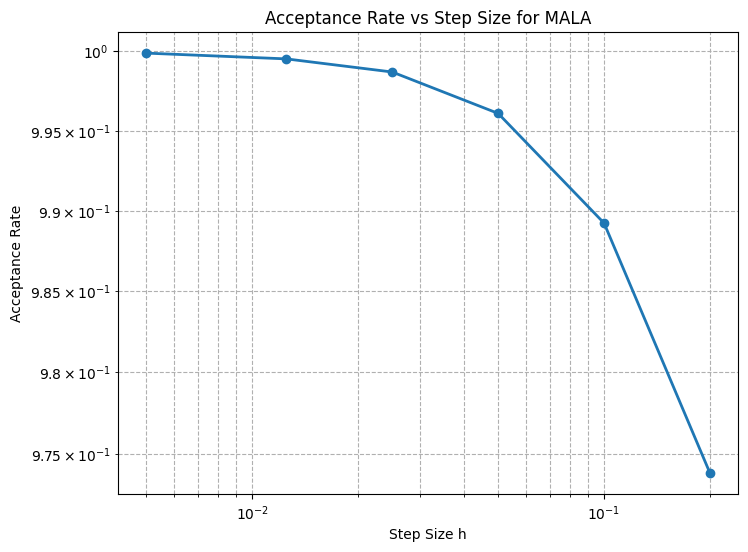 | 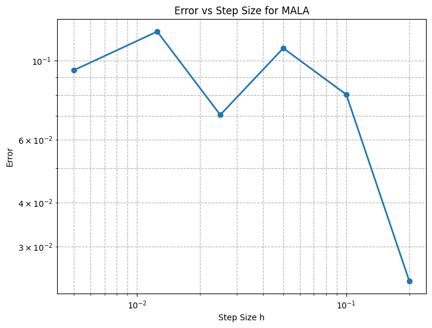 |

- **Acceptance rate:** it rises steadily as $h$ shrinks and approaches **1** as $h \to 0^+$. The plot gives finer values than the 2-decimal printout: ≈ 0.974 at h = 0.2, ≈ 0.989 at 0.1, ≈ 0.996 at 0.05, and ≈ 0.9999 at h = 0.005. So the rejection rate falls from about 2.6% to about 0.01%. This matches theory: as $h \to 0$ the Langevin proposal becomes reversible with respect to $p$, so the Metropolis correction almost never rejects.
- **Error:** it shows **no systematic trend with $h$**. Values range from 2.4e-2 to 1.2e-1 with no clear direction, which is expected:
  - The Metropolis step makes MALA leave $p$ exactly invariant, so there is no $O(h^p)$ discretization bias for the sweep to reveal.
  - With 20,000 particles, the Monte Carlo standard error of $\widehat{\mathbb E}[r^2]$ is on the order of $10^{-1}$, the same size as the observed errors.
  - The estimates therefore agree with the reference to within sampling noise at every $h$, which validates the scheme.

#### HMC

| $h$ | Leapfrog steps L = T/h | Acceptance rate | Error in E[r²] |
|---|---|---|---|
| 0.5 | 3 | 0.97 | 2.46e-2 |
| 0.1 | 15 | 1.00 | 4.78e-2 |
| 0.01 | 150 | 1.00 | 1.49e-1 |
| 0.001 | 1500 | 1.00 | 4.18e-2 |

| Acceptance rate vs h | Error vs h |
|---|---|
| 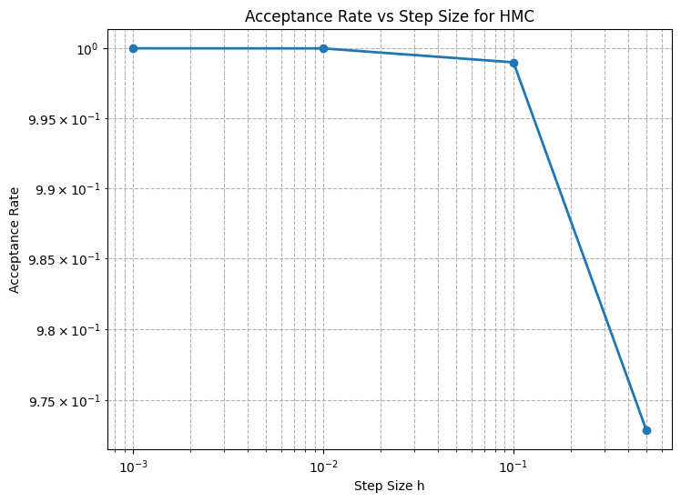 | 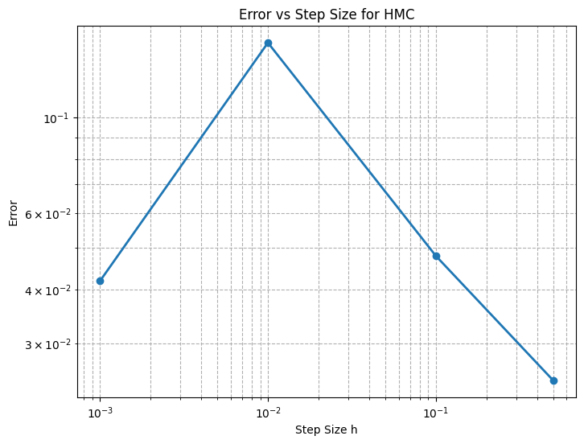 |

- **Acceptance rate:**
  - At h = 0.5 it is ≈ 0.973. At h = 0.1 it is ≈ 0.999 (the printout rounds this to 1.00).
  - At h = 0.01 and h = 0.001 it is exactly 1.000 to plot precision.
  - Leapfrog's energy error is $O(h^2)$ over a fixed-length trajectory, so $|H_{\text{prop}} - H_{\text{curr}}| \to 0$ and the acceptance rate goes to 1 as $h \to 0^+$.
- **Error:** as with MALA, it is non-monotone (2.5e-2 to 1.5e-1). It sits at the Monte Carlo noise level for 20,000 samples, so HMC also agrees with the reference within statistical error.

---

## 6.Normalizing Flow Generative Model

**Training data.** HMC generates 50,000 samples:

- Initialization: $\mathcal N(0, I)$
- 10,000 HMC iterations, h = 0.01, 20 leapfrog steps per iteration

These samples are converted from JAX to a PyTorch tensor.

**Model.** The architecture follows the `normflows` RealNVP example:

- Base distribution: 2D diagonal Gaussian.
- **16 affine coupling blocks.** Each block has a conditioner MLP of shape `[1, 64, 64, 2]` whose last layer is zero-initialized (so every block starts as the identity, which stabilizes training).
- A dimension **swap permutation** after each coupling block, so both coordinates get transformed.

**Training.**

- Loss: forward KL, `model.forward_kld`. This is maximum likelihood, i.e., the negative log-likelihood of the HMC samples.
- Optimizer: Adam, lr = 5e-4, weight decay = 1e-5.
- Batches: 512.
- Length: 4,000 iterations (2 min 14 s, ≈ 30 it/s). The x-axis of the loss plot is labeled "Epochs" but counts iterations.
- Any batch whose loss is NaN or inf is skipped.

| Training loss | Learned density on [-10, 10]² |
|---|---|
| 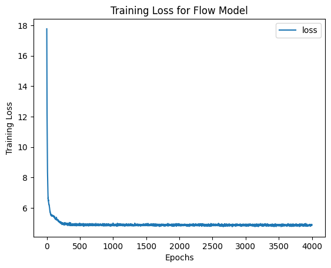 | 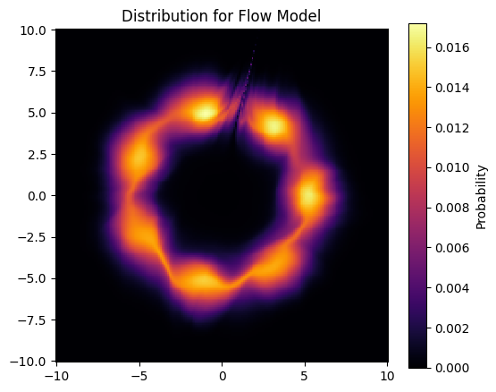 |

**Results:**

- **Loss:** starts at ≈ 17.8, falls below 6 within the first ~100 iterations, and plateaus at **≈ 4.9** by roughly iteration 300. It stays flat for the rest of training.
- **Learned density:** the plot evaluates `exp(model.log_prob)` on a 200×200 grid over $[-10,10]^2$.
  - The flow recovers the **ring at r ≈ 5 with all 7 lobes**, and the center and the far field have essentially zero density. Peak density is ≈ 0.017.
  - Some lobes are sharper or brighter than others.
  - There is a thin **streak artifact** near the top of the ring (around x ≈ 1–2, y ≈ 5–9), a known failure mode of coupling flows. The flow maps a single connected Gaussian onto a ring with a hole, and the coupling layers struggle to "tear" it to make that hole.
  - Overall the flow is a reasonable, though not perfect, generative model of $p$ that can be sampled in a single forward pass.

---

## 7. Summary of Key Numbers

| Question from the assignment | Result |
|---|---|
| Weak order of Euler–Maruyama (theory: 1) | Fitted slope **0.81** over all points (≈ 1.41 over the 3 coarsest h) |
| Weak order of BAOAB (theory: 2) | Fitted slope **1.57** over all points (≈ 2.13 over the 3 coarsest h) |
| Reference E[r²] at T = 5 | 31.758 (EM, from r = 5) · 32.099 (BAOAB, from r = 5 with random v) |
| MALA acceptance as h → 0⁺ | ≈ 0.974 → ≈ 0.9999 as h goes 0.2 → 0.005; **tends to 1** |
| HMC acceptance as h → 0⁺ | ≈ 0.973 → 1.000 as h goes 0.5 → 0.001; **tends to 1** |
| MALA / HMC E[r²] error | 2.4e-2 to 1.5e-1, no trend in h (Monte Carlo noise level) |
| Flow model | NLL plateaus at ≈ 4.9; learned density reproduces the 7-lobed ring |

---

## 8. Implementation Notes and Caveats

- **Reference runs use independent noise.** Each step-size run uses a fresh PRNG subkey, so the convergence errors include Monte Carlo error from both the test run and the reference. This is why both weak-order plots flatten near ~1e-2 even with 5M particles.
- **Reference values differ by method.** EM and BAOAB measure transient expectations at T = 5 for *different* dynamics from different initial conditions (BAOAB also starts with random velocities). Their two reference values (31.76 vs 32.10) are not expected to match.
- **Identical initial positions and velocities.** In the BAOAB sampling cell (Section 4), `x_initial` and `v_initial` are drawn with the **same** PRNG subkey, so the initial position and velocity of every particle are identical. The run is still long enough (T = 20) for this to have no visible effect on the final samples.
- **HMC burn-in.** The `burn_in` argument only drops early iterations from the acceptance-rate average. The returned samples are the final positions either way.
- **Flow batch sampling.** `next(iter(dataloader))` builds a fresh shuffled iterator every iteration. Each step therefore trains on a random batch of 512 drawn from the 50,000 samples, rather than making ordered passes through the data.

---

## 9. Running the Notebook

The notebook was run in a hosted Python 3.11 environment with `torch 2.6.0+cu124` and `normflows 1.7.3`. The flow model uses CUDA if it is available.

Dependencies:

```bash
pip install jax normflows torch matplotlib numpy tqdm
```

Run the cells top to bottom:

| Cells | Content | Notes |
|---|---|---|
| 3–6 | Samplers | |
| 7–10 | Validation studies | Cells 7–8 use 5,000,000 particles and need a lot of memory |
| 11–14 | Normalizing flow | |

Figures in this README were extracted from the notebook's saved outputs into [`sde_sampling_images/`](sde_sampling_images/).
